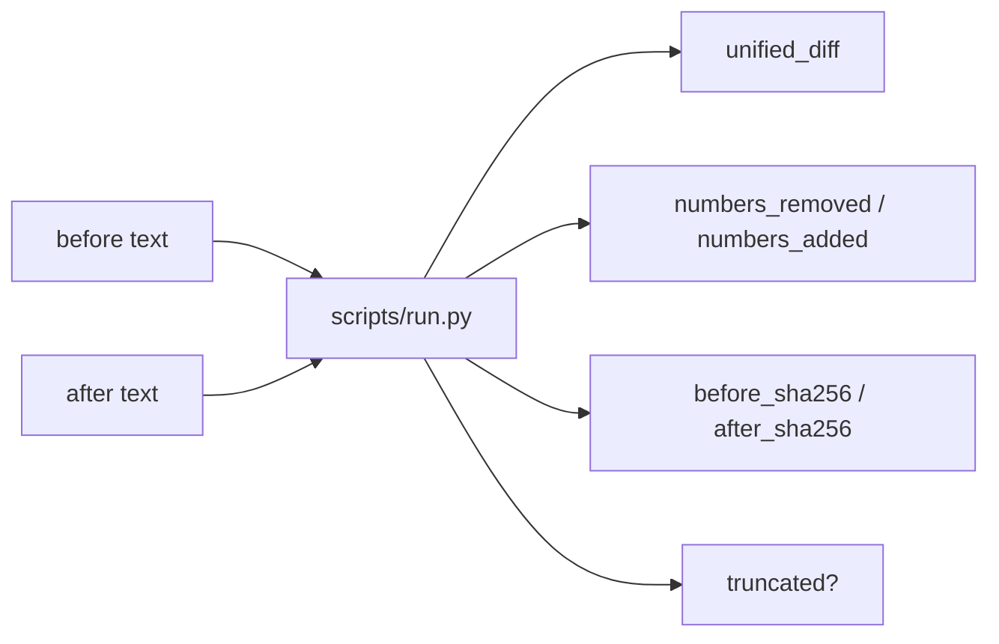

# Document Diff

[English](README.md) · [中文](README.zh-CN.md) · **v0.2.1**

[](https://github.com/KarmenLoop/skill-document-diff/releases/latest)
[](https://www.python.org/downloads/)
[](LICENSE)
[](skill.json)
[](SKILL.md)

**See what changed between two text revisions before you approve—line diff and number churn side by side.**

Approvals fail when a price or deadline changes quietly inside a long paragraph. **Document Diff** is a portable agent skill plus a local Python helper that compares plain-text `before` / `after`, emits a unified diff, lists numbers removed and added, and records SHA-256 of both sides. It compares **text**, not rendered Word or PDF layout. A numerical change is an observation—not a judgment that the revision is acceptable.

Built and maintained by [KarmenLoop](https://github.com/KarmenLoop) / [KARMENLOOP](https://karmenloop.com). Current release: **[v0.2.1](https://github.com/KarmenLoop/skill-document-diff/releases/tag/v0.2.1)**. License: **MIT**.


*Actual local output from v0.2.1, rendered as an image. [Complete result](examples/expected.json) · [Image provenance](docs/images/provenance.json).*

[Download v0.2.1](https://github.com/KarmenLoop/skill-document-diff/releases/tag/v0.2.1) · [Tutorial](docs/tutorial.en.md) · [中文教程](docs/tutorial.zh-CN.md) · [Input contract](docs/INPUT.md)

---

## Why this exists

Generic “summarize the changes” prompts miss single-digit edits. This package surfaces number lists explicitly, detects final-newline and CRLF-only changes, and keeps hashes so you know exactly which text versions were checked.

---

## Snapshot

| | |
|---|---|
| **What you install** | Portable skill (`SKILL.md`, docs, examples) + local helper under `scripts/` |
| **Package name** | `karmen-document-diff` |
| **Version** | **0.2.1** (`skill.json`, release tag, `--version`) |
| **Runtime** | Python **3.9+**, standard library only |
| **Network** | Helper: **offline** (`"network": false` in `skill.json`) |
| **Entry** | `python3 scripts/run.py --input …` · optional `python3 install.py --host agents` |
| **Sample artifact** | [examples/input.json](examples/input.json) → [examples/expected.json](examples/expected.json) |
| **License** | [MIT](LICENSE) — keep [NOTICE.md](NOTICE.md) with redistributed copies |

---

## Is / Is not

| Is | Is not |
|---|---|
| Plain-text unified diff + number add/remove lists | Word / PDF visual layout compare |
| SHA-256 of before and after | OCR for scanned PDFs |
| Optional `max_diff_lines` with `truncated` flag | Legal approval decision |
| CRLF / final-newline awareness | Binary document parser |
| Portable skill + stdlib helper | Document management platform |

---

## How it works

1. **Method layer** — obtain both revisions as text (extract first if needed); set labels; decide review scope; never treat a detected number change as automatic acceptance.
2. **Helper** — diff lines, extract number tokens, hash both sides, honor `max_diff_lines`.

### Flow



### Sample (v0.2.1)

Delivery **5 → 3** days and price **100 → 120** USD appear in both the number lists and the unified diff; `truncated` is false. See [examples/expected.json](examples/expected.json).

---

## Quickstart

### A. Run the helper (no agent host required)

1. Download `karmen-document-diff-v0.2.1.zip` and its `.sha256` from the [v0.2.1 release](https://github.com/KarmenLoop/skill-document-diff/releases/tag/v0.2.1).
2. Verify the hash, then extract.
3. In the extracted directory, with Python 3.9+:

```sh
python3 scripts/run.py --version
python3 scripts/run.py --input examples/input.json
```

Expected version string: `karmen-document-diff 0.2.1`. JSON lands on stdout. Use `--output new-result.json` to keep a copy without overwriting existing files. Pipe mode: `--input -`.

### B. Install the portable skill

For hosts that read `~/.agents/skills` (or a project `.agents/skills`):

```sh
python3 install.py --host agents
```

The installer **refuses an existing destination**—use a fresh path or remove the old copy first. Host discovery and invocation vary; see [docs/tutorial.en.md](docs/tutorial.en.md). You can keep using the helper directly without any AI host.

### Use it with your own work

- Supply `before` and `after` as text, with optional revision labels.
- Set `max_diff_lines` for large documents; check `truncated` before relying on an excerpt.
- Compare identical wording with different line endings or a missing final newline.
- Keep the SHA-256 fields to identify exactly which text versions were checked.

Read [docs/INPUT.md](docs/INPUT.md) before preparing new input. The helper needs no model account, API key, or network connection. An AI host has its own data and permission settings; this skill adds no authority to send, purchase, publish, or change access.

---

## Documentation map

| Doc | Use it when you need… |
|---|---|
| [Tutorial (EN)](docs/tutorial.en.md) · [中文](docs/tutorial.zh-CN.md) | Download, install, practice, upgrade, remove |
| [INPUT.md](docs/INPUT.md) · [input.zh-CN.md](docs/input.zh-CN.md) | Field contract |
| [COMPATIBILITY.md](docs/COMPATIBILITY.md) | Host / runtime notes |
| [VALIDATION.md](docs/VALIDATION.md) | What checks cover |
| [SOURCES.md](docs/SOURCES.md) | Provenance pointers |
| [CHANGELOG.md](CHANGELOG.md) | History through 0.2.1 |
| [SECURITY.md](SECURITY.md) / [SUPPORT.md](SUPPORT.md) / [CONTRIBUTING.md](CONTRIBUTING.md) | Ops |

---

## FAQ

### What is Document Diff in one sentence?

A MIT-licensed agent skill and offline helper that diffs two plain-text revisions and highlights number changes before approval.

### Can it compare scanned PDFs?

Extract and verify the text with a separate tool first. This package has no OCR or PDF reader.

### Is a number change an approval decision?

No. It is an observation for a human (or a separate policy) to judge.

### Does it modify either document?

No. Read-only analysis; JSON to stdout or a new `--output` file.

### Why keep SHA-256 fields?

So later readers can confirm the exact byte content that was reviewed.

### Soft discoverability

Useful phrases: **plain text document diff for agents**, **number change detection in revisions**, **contract redline helper offline**, **SHA-256 verified text compare**. Avoid stuffing; the substance is in the skill and helper, not keyword density.

---

## License and contact

[MIT](LICENSE). Keep the license and [NOTICE.md](NOTICE.md) with redistributed copies.

Maintainer: [KarmenLoop](https://github.com/KarmenLoop) · Site: [karmenloop.com](https://karmenloop.com)

Issues: [GitHub Issues](https://github.com/KarmenLoop/skill-document-diff/issues) · Support policy: [SUPPORT.md](SUPPORT.md). Prefer synthetic data when filing example bugs.
