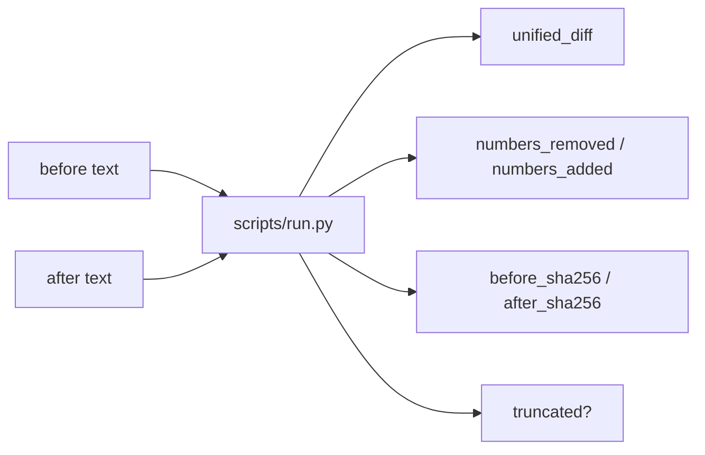

# 文档差异 · Document Diff

[English](README.md) · [中文](README.zh-CN.md) · **v0.2.1**

[](https://github.com/KarmenLoop/skill-document-diff/releases/latest)
[](https://www.python.org/downloads/)
[](LICENSE)
[](skill.json)
[](SKILL.md)

**批准修订前先看清改了什么：逐行差异与增删数字并排列出。**

价格或期限悄悄改在长段落里时，审批就会漏看。**文档差异**是可移植的 Agent Skill，外加本地 Python 助手：比较纯文本 `before` / `after`，输出统一差异、增删数字列表，以及两侧 SHA-256。比较的是**文本**，不是 Word / PDF 排版。数字变化只是观察——不等于修订可接受。

由 [KarmenLoop](https://github.com/KarmenLoop) / [KARMENLOOP](https://karmenloop.com) 维护。当前发行版：**[v0.2.1](https://github.com/KarmenLoop/skill-document-diff/releases/tag/v0.2.1)**。许可：**MIT**。


*图片来自 v0.2.1 的真实本地输出（英文键名）。[完整结果](examples/expected.json) · [图片来源记录](docs/images/provenance.json)。*

[下载 v0.2.1](https://github.com/KarmenLoop/skill-document-diff/releases/tag/v0.2.1) · [中文教程](docs/tutorial.zh-CN.md) · [English tutorial](docs/tutorial.en.md) · [输入契约](docs/input.zh-CN.md)

---

## 为什么需要它

笼统的“总结一下改动”容易漏掉个位数修改。本包显式列出数字变化，能识别仅末尾换行或 CRLF 差异，并用哈希锁定被核对的究竟是哪两版文本。

---

## 一览

| | |
|---|---|
| **安装内容** | 可移植 Skill（`SKILL.md`、文档、样例）+ `scripts/` 下本地助手 |
| **包名** | `karmen-document-diff` |
| **版本** | **0.2.1**（`skill.json`、发行标签、`--version`） |
| **运行时** | Python **3.9+**，仅标准库 |
| **网络** | 助手：**离线**（`skill.json` 中 `"network": false`） |
| **入口** | `python3 scripts/run.py --input …` · 可选 `python3 install.py --host agents` |
| **样例产物** | [examples/input.json](examples/input.json) → [examples/expected.json](examples/expected.json) |
| **许可** | [MIT](LICENSE) — 再分发时保留 [NOTICE.md](NOTICE.md) |

---

## 是 / 不是

| Is | Is not |
|---|---|
| 纯文本统一差异 + 数字增删列表 | Word / PDF 视觉排版对比 |
| 前后文本 SHA-256 | 扫描件 OCR |
| 可选 `max_diff_lines` 与 `truncated` 标志 | 法律意义上的批准结论 |
| 感知 CRLF / 末尾换行差异 | 二进制文档解析器 |
| 可移植 Skill + 标准库助手 | 文档管理平台 |

---

## 如何工作

1. **方法层** — 取得两版纯文本（需要时先抽取）；设置版本标签；划定审阅范围；切勿把检测到的数字变化当成自动接受。
2. **助手** — 行差异、数字 token、两侧哈希，并遵守 `max_diff_lines`。

### 流程



### 样例（v0.2.1）

交付 **5 → 3** 天、价格 **100 → 120** 美元会同时出现在数字列表与统一差异中；`truncated` 为 false。详见 [examples/expected.json](examples/expected.json)。

---

## 快速开始

### A. 直接跑助手（不需要 AI 宿主）

1. 从 [v0.2.1 发行页](https://github.com/KarmenLoop/skill-document-diff/releases/tag/v0.2.1) 下载 `karmen-document-diff-v0.2.1.zip` 与对应 `.sha256`。
2. 核对哈希后解压。
3. 在解压目录中使用 Python 3.9+：

```sh
python3 scripts/run.py --version
python3 scripts/run.py --input examples/input.json
```

期望版本字符串：`karmen-document-diff 0.2.1`。JSON 默认输出到 stdout。用 `--output new-result.json` 落盘且不覆盖已有文件。管道：`--input -`。

### B. 安装可移植 Skill

若宿主读取 `~/.agents/skills`（或项目内 `.agents/skills`）：

```sh
python3 install.py --host agents
```

安装器**拒绝已存在的目标目录**——请换新路径或先移除旧副本。宿主发现与调用方式因环境而异；见 [docs/tutorial.zh-CN.md](docs/tutorial.zh-CN.md)。也可以完全不装宿主，只跑助手。

### 用于你自己的工作

- 以文本提供 `before` / `after`，可选版本标签。
- 大文档设置 `max_diff_lines`；依赖摘录前先看 `truncated`。
- 对比措辞相同但换行不同、或缺少末尾换行的情形。
- 保留 SHA-256 字段，以确认核对的是哪两版文本。

准备新输入前请阅读 [docs/input.zh-CN.md](docs/input.zh-CN.md) / [docs/INPUT.md](docs/INPUT.md)。助手不需要模型账号、API 密钥或网络。AI 宿主有自己的数据与权限设定；本 Skill **不**额外授予发送、购买、发布或改权限的权力。

---

## 文档地图

| 文档 | 用途 |
|---|---|
| [中文教程](docs/tutorial.zh-CN.md) · [English](docs/tutorial.en.md) | 下载、安装、练习、升级、移除 |
| [input.zh-CN.md](docs/input.zh-CN.md) · [INPUT.md](docs/INPUT.md) | 字段契约 |
| [COMPATIBILITY.md](docs/COMPATIBILITY.md) | 宿主 / 运行时说明 |
| [VALIDATION.md](docs/VALIDATION.md) | 校验覆盖范围 |
| [SOURCES.md](docs/SOURCES.md) | 来源与溯源 |
| [CHANGELOG.md](CHANGELOG.md) | 至 0.2.1 的历史 |
| [SECURITY.md](SECURITY.md) / [SUPPORT.md](SUPPORT.md) / [CONTRIBUTING.md](CONTRIBUTING.md) | 运维 |

---

## 常见问题

### 一句话：文档差异是什么？

MIT 许可的 Agent Skill 与离线助手：对比两版纯文本修订，并在批准前突出数字变化。

### 能对比扫描 PDF 吗？

请先用其他工具抽取并核对文本。本包没有 OCR 或 PDF 阅读器。

### 数字变化等于批准结论吗？

不等于。那只是观察，需由人或单独策略判断。

### 会修改任一文档吗？

不会。只读分析；结果到 stdout 或新的 `--output` 文件。

### 为什么保留 SHA-256？

方便后来者确认当时审阅的究竟是哪一版字节内容。

### 温和可发现性

可用检索说法：**面向代理的纯文本文档差异**、**修订中的数字变化检测**、**离线合同红线助手**、**带 SHA-256 的文本比对**。 避免堆砌；实质在 Skill 与助手里，不在关键词密度。

---

## 许可与联系

[MIT](LICENSE)。再分发时请保留许可证与 [NOTICE.md](NOTICE.md)。

维护者：[KarmenLoop](https://github.com/KarmenLoop) · 站点：[karmenloop.com](https://karmenloop.com)

问题反馈：[GitHub Issues](https://github.com/KarmenLoop/skill-document-diff/issues) · 支持政策：[SUPPORT.md](SUPPORT.md)。提交样例相关问题时请优先使用合成数据。
