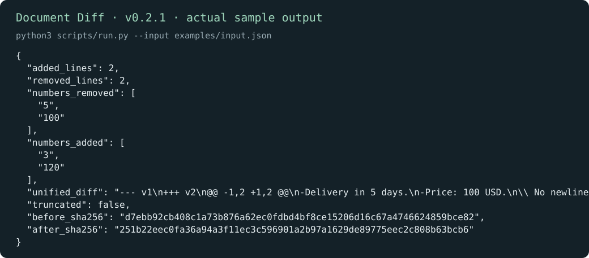

# Document Diff · 文档差异

[English](README.md) | 简体中文

批准一版文档之前，先看清楚改了什么。逐行差异和增删数字会同时列出，便于发现价格、期限等容易漏看的变化。

[下载 v0.2.1](https://github.com/KarmenLoop/skill-document-diff/releases/tag/v0.2.1) · [完整教程](docs/tutorial.zh-CN.md) · [输入参考（英文）](docs/INPUT.md) · [反馈问题](https://github.com/KarmenLoop/skill-document-diff/issues)

## 能做什么

样例把交付从 5 天改为 3 天、价格从 100 改为 120 美元；数字列表和统一差异都会显示这些修改。

工具比较纯文本，不检查 Word 或 PDF 的排版。发现数字变化只是一条观察，是否接受仍需审阅。



*图片来自 v0.2.1 的真实本地输出，采用英文键名；[完整结果](examples/expected.json) · [图片来源记录](docs/images/provenance.json)。*

## 开始使用

在发行页下载 `karmen-document-diff-v0.2.1.zip` 与对应 `.sha256` 文件，核对哈希后解压。在解压目录中使用 Python 3.9 或更新版本：

```sh
python3 scripts/run.py --version
python3 scripts/run.py --input examples/input.json
```

预期版本：`karmen-document-diff 0.2.1`。样例把交付从 5 天改为 3 天、价格从 100 改为 120 美元；数字列表和统一差异都会显示这些修改。

如果宿主读取 `~/.agents/skills`，可安装完整技能：

```sh
python3 install.py --host agents
```

目标目录已存在时安装器会拒绝覆盖。宿主发现和调用方式可能不同，见[安装与实践教程](docs/tutorial.zh-CN.md)。不使用 AI 宿主也能直接运行本地工具。

## 用于自己的任务

before 与 after 填写文本，可附版本标签。长文档可设置 max_diff_lines；依据节选判断前，先看 truncated 是否为 true。

试着比较文字相同、换行方式不同或缺少末尾换行的两个版本。保留 SHA-256 字段，明确检查的是哪份文本。

准备新输入前可查看[字段约定（英文）](docs/INPUT.md)。工具只依赖 Python 标准库，本身不需要模型账号、API 密钥或网络。使用 AI 宿主时，宿主有自己的数据与权限设置。

## 常见问题

**能比较扫描 PDF 吗？** 需要先用其他工具提取并核对文字；本包不包含 OCR 或 PDF 阅读器。

**结果保存在哪里？** 默认向终端输出 JSON；使用 `--output` 时只创建新文件，已有输出文件会保留。工具只读取提交的记录和输入约定中明确列出的本地路径。

## 文档与支持

- [下载、安装、配置、练习、升级与卸载](docs/tutorial.zh-CN.md)
- [输入输出约定](docs/INPUT.md)与[兼容性说明](docs/COMPATIBILITY.md)（英文参考）
- [更新记录](CHANGELOG.md)、[参与贡献](CONTRIBUTING.md)、[支持](SUPPORT.md)和[安全反馈](SECURITY.md)

## 许可证

[MIT](LICENSE)。再分发时保留许可证和[声明](NOTICE.md)。由 [KarmenLoop](https://karmenloop.com) 维护。
